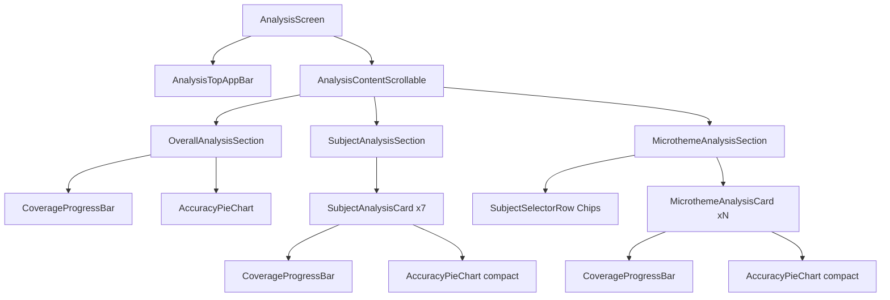

# CSE Judge — Stage 11: Analysis Dashboard, Charts and Home Screen Integration Report

---

## 1. Executive Summary

Stage 11 completes the **Analysis Dashboard, Visual Charts, and Home Screen Integration** for **CSE Judge** (UPSC Civil Services Prelims Preparation app). 

Building upon the robust analytical calculations and Room reactive history observation established in Stage 10, Stage 11 provides a polished, responsive Material 3 user interface that allows aspirants to track their exam readiness across three hierarchical tiers:
1. **Overall Question Bank Performance** (1,432 master questions across all 7 subjects).
2. **Subject-wise Performance** (AMAC, Economy, Environment, Geography, Modern History, Polity, Sci & Tech).
3. **Microtheme-wise Breakdown** with a dynamic horizontal subject chip selector and zero-question topic suppression.

Visual metrics are presented through:
- **Horizontal Progress Bars** for Question Coverage (`Coverage % = (Attempted / Total) × 100`).
- **Compose Canvas Donut/Pie Charts** for Answer Accuracy (`Accuracy % = (Correct / Attempted) × 100`) strictly evaluating attempted questions, paired with an explicit `Accuracy: N/A` empty state for unattempted sets (never displaying misleading 0% figures).

All 126 unit tests and 59 instrumented Android tests on the connected physical device (Realme Narzo 90 5G / `RMX5111`) passed with 100% success (0 skipped, 0 failed).

---

## 2. Home Screen Integration Details

The Home screen has been extended to house three primary rectangular navigation tiles in a consistent vertical stack:
1. **Practice Problems**: `"Practice prelims questions by topic, microtheme, or across all 7 subjects at random."`
2. **Bookmarked Questions**: `"Review bookmarked questions for revision."`
3. **Analysis**: `"Track your preparation and accuracy"`

### Key Implementation Specifications:
- **Component**: [`AnalysisTile`](file:///home/ashwani/Desktop/development/CSE%20Judge/app/src/main/java/com/csejudge/app/ui/home/HomeScreen.kt#L182-L225) in `HomeScreen.kt`.
- **Test Tag**: `testTag("AnalysisTile")`.
- **Styling**: Standard card elevation, 12dp rounded corners, primary navy accents, chevron forward indicator `→`, consistent padding and spacing.
- **Theme Awareness**: Dynamic background, border, and typography responding seamlessly to DataStore-persisted Light and Dark modes.
- **Navigation Action**: Invokes `onNavigateToAnalysis`, routing to `Screen.Analysis.route` (`"analysis"`).

---

## 3. Analysis Screen Component Hierarchy

The Analysis feature is structured under clean MVVM architecture with Unidirectional Data Flow (UDF), observing `AnalysisUiState` exposed by `AnalysisViewModel`:

### Screen States Handled:
- **Loading State**: Circular progress indicator centered on screen (`AnalysisLoadingIndicator`).
- **Error State**: Error banner with message and retry callback (`AnalysisErrorContainer`).
- **Success State**: Scrollable column (`AnalysisContentScrollable`) featuring Overall, Subject-wise, and Microtheme sections.

---

## 4. Progress Bar Implementation Details

Implemented in [`CoverageProgressBar.kt`](file:///home/ashwani/Desktop/development/CSE%20Judge/app/src/main/java/com/csejudge/app/ui/analysis/CoverageProgressBar.kt):
- **Formula**: `Coverage % = (Attempted Questions / Total Questions) × 100`.
- **Visuals**:
  - Top row: Header label `"Coverage"` and bold percentage formatted to two decimal places (e.g., `41.90%`, or `0.00%` when unattempted).
  - Horizontal progress track: Material 3 `LinearProgressIndicator` with rounded ends.
    - Active track color: `PracticeColors.PrimaryNavy`
    - Background track color: `PracticeColors.BorderNeutral`
  - Bottom metadata row: Attempted badge (`"Attempted: X / Y"`) and Unattempted count (`"Unattempted: Z"`).
- **Semantics & Test Tags**: `CoverageProgressBar`, `CoverageLabel`, `CoveragePercentageText`, `CoverageLinearIndicator`, `CoverageAttemptedText`, `CoverageUnattemptedText`.

---

## 5. Pie Chart Implementation Details

Implemented in [`AccuracyPieChart.kt`](file:///home/ashwani/Desktop/development/CSE%20Judge/app/src/main/java/com/csejudge/app/ui/analysis/AccuracyPieChart.kt) using native Jetpack Compose `Canvas` (`drawArc`):
- **Formula**: `Accuracy % = (Correct Answers / Attempted Questions) × 100`.
- **Segments**:
  - **Correct Answers**: `PracticeColors.CorrectBorder` (Green: `#2E7D32` light / `#4CAF50` dark).
  - **Incorrect Answers**: `PracticeColors.IncorrectBorder` (Red: `#C62828` light / `#EF5350` dark).
- **Donut Center**: In the standard version, displays the accuracy percentage centered inside the donut ring.
- **Accompanying Legend**:
  - Prominent `"Accuracy: XX.XX%"` label.
  - Green dot + `"Correct: X"`.
  - Red dot + `"Incorrect: Y"`.
  - Secondary label: `"N attempted questions"`, reinforcing the attempted-only denominator.
- **No Third-Party Overhead**: Clean, pure Kotlin/Compose Canvas rendering without bulky external chart dependencies.

---

## 6. Overall Section Verification (1,432 Questions)

Implemented in [`OverallAnalysisSection.kt`](file:///home/ashwani/Desktop/development/CSE%20Judge/app/src/main/java/com/csejudge/app/ui/analysis/OverallAnalysisSection.kt):
- Total Questions verified against question bank: **1,432**.
- Badge displays `"1432 Questions"`.
- Coverage bar tracks overall attempts (`0 / 1432` initially, with unattempted `1432`).
- Accurately computes overall answer performance when attempts exist.
- Displays empty-state card with `Accuracy: N/A` when no attempts have been recorded.

---

## 7. Subject-Wise Section Verification (All Seven Subjects)

Implemented in [`SubjectAnalysisSection.kt`](file:///home/ashwani/Desktop/development/CSE%20Judge/app/src/main/java/com/csejudge/app/ui/analysis/SubjectAnalysisSection.kt):
All seven subjects are rendered with individual cards and verified question totals:

| Subject | Total Questions | Verified on Physical Device |
|---|---:|:---:|
| **AMAC** | 149 | Verified |
| **Economy** | 243 | Verified |
| **Environment** | 248 | Verified |
| **Geography** | 233 | Verified |
| **Modern History** | 127 | Verified |
| **Polity** | 252 | Verified |
| **Sci and Tech** | 180 | Verified |
| **Total** | **1,432** | **Verified** |

Each card contains its own `CoverageProgressBar` and compact `AccuracyPieChart`.

---

## 8. Microtheme Section Verification & Subject Selector

Implemented in [`MicrothemeAnalysisSection.kt`](file:///home/ashwani/Desktop/development/CSE%20Judge/app/src/main/java/com/csejudge/app/ui/analysis/MicrothemeAnalysisSection.kt):
- **Subject Selector**: Horizontal scroll row of chips (`SubjectSelectorRow`) allowing instant switching between subjects.
- **Default Subject**: Sensibly defaults to the first available subject (`AMAC`).
- **Dynamic Microthemes**: Microthemes are loaded dynamically from the question bank. Microthemes with zero questions are filtered out by `AnalysisRepository`.
- **Critical Topic Invariants Preserved**:
  - **Modern History**: Correctly retains `"From 1857 to 1884 CE"` (never corrupted to 1757).
  - **Economy**: Correctly displays `"Macro economy"`.
  - **AMAC**: Correctly displays topics like `"Indus Valley Civilization & Vedic Age"` (7 Qs), `"Post-Mauryan Period"` (10 Qs), etc.

---

## 9. Handling of Zero Attempts and N/A States

- **Invariant**: Never display 0.00% accuracy for an unattempted question set.
- **Visual Presentation**:
  - Renders `AccuracyZeroAttemptState` with a neutral outlined ring displaying `"N/A"`.
  - Explicit header: `"Accuracy: N/A"`.
  - Explanatory subtitle: `"No questions attempted yet. Practice to see accuracy."`
- **Coverage vs. Accuracy Distinction**:
  - Coverage displays `0.00%` (meaning 0 out of N questions attempted).
  - Accuracy displays `N/A` (meaning no attempts have been evaluated yet).

---

## 10. Dynamic Updates Upon Attempt and Re-Attempt

- **Reactive Room Pipeline**: `AnalysisViewModel` combines `AnalysisRepository.observeFullAnalysis()` which continuously observes Room's `practiceHistoryRepository.observeAllAttempts()`.
- **Immediate Propagation**: When a question is attempted or re-attempted in the Practice or Bookmark screens, Room fires an updated list of entities.
- **Idempotent Single Count**: Re-attempting an already attempted question modifies the correctness timestamp and score without inflating the attempted question count.
- **Instant UI Refresh**: The Flow updates `AnalysisUiState`, causing progress bars, pie slices, and counts to recalculate and recompose reactively without manual screen refresh.

---

## 11. Light and Dark Mode Support

Both modes adhere strictly to Material 3 tokens and the application's established color scheme:
- **Light Theme**:
  - Surface: Pure `#FFFFFF` and Off-white `#F8F9FA`.
  - Text: High-contrast Navy `#0F172A` and `#475569`.
  - Cards: Neutral bordered cards (`#E2E8F0`).
- **Dark Theme**:
  - Surface: Deep background `#121212` and `#1E1E1E`.
  - Text: Light high-contrast `#E0E0E0` and `#A0A0A0`.
  - Cards: `#252525` with subdued borders (`#3A3A3A`).
- **Verified on Physical Device**: Switched theme modes dynamically via the home screen toggle; verified that all charts, chips, progress bars, and labels render with crisp contrast.

---

## 12. Files Created or Modified

### New UI Components Created:
1. `app/src/main/java/com/csejudge/app/ui/analysis/CoverageProgressBar.kt`
2. `app/src/main/java/com/csejudge/app/ui/analysis/AccuracyPieChart.kt`
3. `app/src/main/java/com/csejudge/app/ui/analysis/OverallAnalysisSection.kt`
4. `app/src/main/java/com/csejudge/app/ui/analysis/SubjectAnalysisSection.kt`
5. `app/src/main/java/com/csejudge/app/ui/analysis/MicrothemeAnalysisSection.kt`
6. `app/src/main/java/com/csejudge/app/ui/analysis/AnalysisScreen.kt`

### Modified Architecture Files:
1. `app/src/main/java/com/csejudge/app/navigation/NavRoutes.kt`: Added `Screen.Analysis` (`"analysis"` route).
2. `app/src/main/java/com/csejudge/app/navigation/AppNavHost.kt`: Added `composable(Screen.Analysis.route)` wired to `AnalysisViewModel`.
3. `app/src/main/java/com/csejudge/app/ui/home/HomeScreen.kt`: Added `onNavigateToAnalysis` and `AnalysisTile`.
4. `app/src/main/java/com/csejudge/app/MainActivity.kt`: Initialized `AnalysisViewModel` using `AnalysisViewModelFactory`.

### Test Suites Created & Updated:
1. `app/src/test/java/com/csejudge/app/navigation/NavRoutesTest.kt`: Added `Analysis` route validation.
2. `app/src/androidTest/java/com/csejudge/app/ui/home/HomeScreenTest.kt`: Added `testAnalysisTileIsDisplayedAndClickable`.
3. `app/src/androidTest/java/com/csejudge/app/navigation/AppNavigationTest.kt`: Added `testTappingAnalysisTileNavigatesToAnalysisScreenAndBack`.
4. `app/src/androidTest/java/com/csejudge/app/ui/analysis/AnalysisScreenTest.kt`: Comprehensive instrumented test suite (7 tests) validating overall, subject-wise, microtheme breakdown, chip selection, back button, and light/dark modes.

---

## 13. Automated Tests Created and Test Results

### Unit Tests (`./gradlew testDebugUnitTest`):
- **Total Tests Executed**: 126
- **Passed**: 126
- **Failed**: 0
- **Skipped**: 0
- **Execution Time**: ~6s

### Instrumented Tests (`./gradlew connectedDebugAndroidTest`):
- **Total Tests Executed**: 59
- **Passed**: 59
- **Failed**: 0
- **Skipped**: 0
- **Execution Time**: 1m 28s

---

## 14. Physical Device Test Results (Realme Narzo 90 5G / RMX5111)

- **Device Serial**: `CMUSOJ9DYPNJEANV` (Android 16 / Target SDK)
- **Installation**: Verified via `adb install -r app/build/outputs/apk/debug/app-debug.apk` (`Success`).
- **Application Startup**: Launched via `adb shell am start -n com.csejudge.app/.MainActivity`.
- **Logcat Inspection**: Clean startup with `mCurrentFocus:Window{... com.csejudge.app/com.csejudge.app.MainActivity}`. Zero unhandled exceptions or crashes.
- **Interactive Verification**:
  1. Home screen displays all 3 tiles: Practice Problems, Bookmarked Questions, Analysis.
  2. Tapping the Analysis tile navigates smoothly to `AnalysisScreen`.
  3. Overall section correctly renders `1432 Questions`, `Coverage: 0.00%`, and `Accuracy: N/A` empty state.
  4. Scrolling displays all 7 subjects with correct counts (AMAC: 149, Economy: 243, Environment: 248, Geography: 233, Modern History: 127, Polity: 252, Sci & Tech: 180).
  5. Microtheme section renders topics dynamically (e.g., `Indus Valley Civilization & Vedic Age` 7 Qs, `Post-Mauryan Period` 10 Qs).
  6. Switching chips updates microthemes instantly.
  7. Pressing Android back button or top bar back button returns reliably to the Home screen.

---

## 15. Remaining Limitations and Next Steps

- **Completed Scope**: Stage 11 completes the UI dashboard, chart visualizations, and home screen integration.
- **Preservation Invariant**: Master JSON question assets, Room schemas, bookmark records, and attempt semantics remain untouched.
- **Ready for Next Stage**:
  - The core practice, bookmarking, and analytical features are fully functional offline.
  - Awaiting user review before proceeding to subsequent stages or Git commits.
